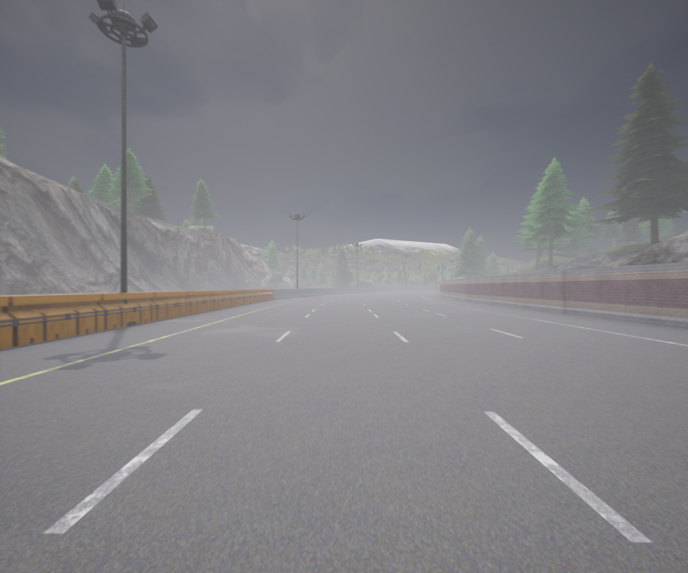

# CARLA Autonomous Driving Model

An image-based steering model trained on CARLA driving recordings.

> **Status: early prototype.** This is a first attempt at an image-based steering model. It is not very reliable yet and should not be considered a finished autonomous-driving system. It can learn basic steering behavior from the collected recordings, but its performance depends heavily on the quality, variety, and balance of the training data.

The model will be strengthened and improved over time through better data collection, training adjustments, and driving validation.

This folder contains the notebooks used to collect driving data, train a steering model, and test the model in CARLA.

---

## Contents

- [Dataset](#dataset)
- [Workflow](#workflow)
- [What the model learns](#what-the-model-learns)
- [Notebooks](#notebooks)
  - [collect_data.ipynb](#collect_dataipynb)
  - [train.ipynb](#trainipynb)
  - [drive.ipynb](#driveipynb)
- [Saved models](#saved-models)
- [Current limitations](#current-limitations)
- [Future improvements](#future-improvements)
- [Requirements and setup](#requirements-and-setup)

---

## Dataset

The driving data was collected by the author over a 30-minute recording session, with camera images at a resolution of 1200 × 1000.

The dataset is available on Kaggle: **[will add it lately]**



Each dataset folder contains an images directory and a log.csv file that pairs each image with its steering value. An excerpt of log.csv looks like this:

```csv
image,steering
388640.png, 0.019261997193098068
388655.png, 0.011902821250259876
388660.png, 0.00937462132424116
```

To use it, download the dataset and place it where the `models` and `main` are, then point `train.ipynb` to that folder.

---

## Workflow

The notebooks are intended to be run in this order:

| Step | Notebook | Purpose |
|:---:|---|---|
| 1 | `collect_data.ipynb` | Records camera images and the steering values produced by a CARLA vehicle on autopilot. |
| 2 | `train.ipynb` | Loads the recorded dataset and trains a convolutional neural network to predict steering from an image. |
| 3 | `drive.ipynb` | Loads the trained network and uses its predictions to steer a vehicle in CARLA. |

The same image preparation is used during training and driving, so the model receives inputs in the format it learned from.

---

## What the model learns

The model performs **supervised learning**. Each training image is paired with the steering value that CARLA's autopilot used for that frame. During training, the network compares its predicted steering value with the recorded value and adjusts its internal parameters to reduce the difference.

After training, the model does not use CARLA's autopilot to choose steering. It uses only the current camera image to predict a steering value, and the driving notebook applies that prediction to the vehicle.

---

## Notebooks

### collect_data.ipynb

This notebook connects to a CARLA server on the local computer and loads **Town04**. It creates a **Ford Mustang**, attaches an RGB camera to it, and configures the vehicle to follow a fixed route using CARLA's traffic manager.

During recording:

- The camera callback processes every fifth camera frame.
- Each selected image is saved in an `images` folder.
- The vehicle's current steering value is saved alongside the image name in `log.csv`.

The dataset is stored under `D:\CARLA data`. If the target folder already exists, the notebook creates a numbered folder instead, so an earlier recording is never overwritten.

Recording continues for the configured duration. Afterward, the camera and vehicle are destroyed and the log file is flushed and closed.

> The collected data represents the autopilot's behavior on the selected route. It does not automatically cover every road layout, weather condition, traffic situation, or unusual vehicle position, which limits how well the first model can generalize beyond the recording.

### train.ipynb

This notebook reads images and steering values from a selected dataset folder.

**Preprocessing.** Each image is loaded once, cropped to remove the upper part of the view, resized to 200 × 66 pixels, converted from BGR to RGB, normalized, and stored as a PyTorch tensor.

**Data split.** The data is divided chronologically: the first 80% is used for training and the final 20% for validation. This avoids placing nearly identical frames from the same part of a recording in both sets. Steering values are also balanced by sampling steering ranges more evenly, which reduces the effect of recordings dominated by straight driving.

**Model.** The model is a convolutional neural network. Its convolutional layers extract visual features from the road image, and fully connected layers convert those features into a single steering prediction. The output uses a hyperbolic tangent activation, so predictions are limited to the range −1 to 1.

**Training setup.**

- Optimizer: AdamW
- Loss: Smooth L1
- Augmentation: random horizontal mirroring (with the steering value inverted) and moderate brightness changes
- Gradient clipping to limit unusually large updates
- Up to 30 epochs, with validation loss controlling learning-rate reduction and early stopping

**Outputs.** Whenever validation improves, the model state is saved to `../models/steer_mercedes.pt`. After training, the best state is restored and also saved to `../models/steer.pt`.

The notebook plots training and validation loss and prints steering-value statistics when training finishes.

> The complete dataset is loaded into GPU memory when CUDA is available, so the GPU must have enough memory for the selected dataset.

> Validation loss is useful for measuring progress, but a lower validation loss does not guarantee safe or stable driving in CARLA. Driving quality must also be checked during actual runs, because small steering errors can accumulate over time.

### drive.ipynb

This notebook connects to the local CARLA server, loads **Town04**, and creates a **Mercedes coupe** with an attached RGB camera. It rebuilds the same network architecture used during training and loads the saved weights from `../models/steer_mercedes.pt`.

On each frame:

1. The camera image is converted into the same cropped, resized, RGB, and normalized format used in training.
2. The image is passed to the model on the GPU.
3. The predicted steering value is applied directly to the vehicle.

**Speed control.** Vehicle speed is calculated from its CARLA velocity. Throttle is applied while the vehicle is below the configured target speed and removed once that speed is reached. The driving callback runs for the configured duration.

At the end of the run, the camera is stopped and both the camera and vehicle actors are destroyed.

---

## Saved models

The `models` folder contains the trained network weights:

| File | Description |
|---|---|
| `steer_1.pt` | First training attempt. |
| `steer_mercedes.pt` | Best model so far. This is the model `drive.ipynb` loads. |

Later training runs may overwrite `steer_mercedes.pt` when validation improves, so keep a copy of any model you want to preserve before training again.

---

## Current limitations

- The training data comes from a limited route and a single recording setup.
- The model predicts steering from images only. It has no explicit understanding of the map, lane boundaries, vehicle position, or nearby traffic.
- Throttle control is separate from the learned steering model and uses a simple target-speed rule.
- The driving notebook has no recovery behavior when the vehicle leaves the intended path.
- The model has not yet been evaluated across a wide range of routes and conditions.

---

## Future improvements

- Collect more varied and balanced data.
- Improve the training process.
- Test the model on additional routes and conditions.
- Add more robust vehicle control and recovery behavior.

This first version is a starting point that will be strengthened and made more reliable.

---

## Requirements and setup

### Software

- **CARLA** running and listening on `localhost:2000` before either data collection or driving begins
- **Python** environment with CARLA, PyTorch, OpenCV, NumPy, and Matplotlib
- **CUDA** is required by the current driving notebook and is used by training when available

### Notebook dependencies

- The dataset folder used by `train.ipynb` must contain the `images` directory and `log.csv` created by `collect_data.ipynb`.
- The model file loaded by `drive.ipynb` must be created by `train.ipynb` and must match the architecture defined there.

### Configuration

The hard-coded dataset, model, map, vehicle, duration, and speed settings should match your local CARLA installation and the intended experiment before running the notebooks.
